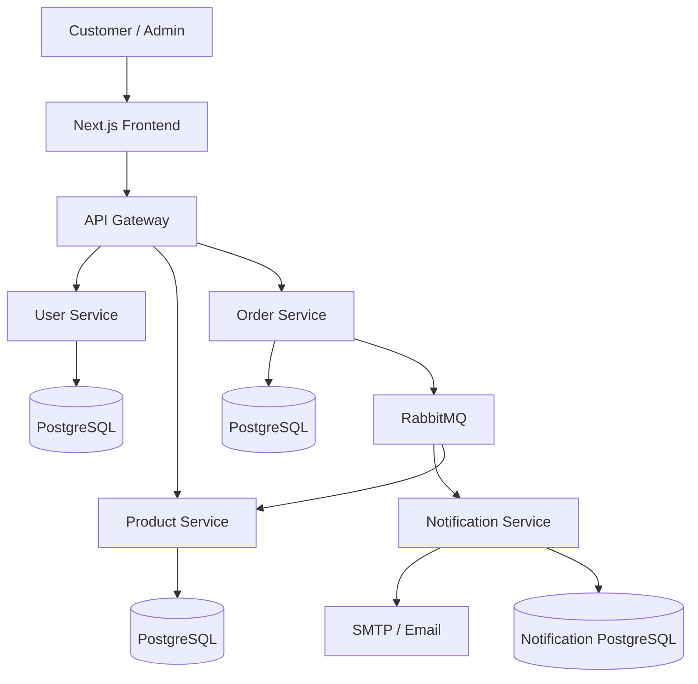

# ShopSphere – Microservices E-Commerce Application

ShopSphere is a full-stack e-commerce application built using a **microservices architecture**. It provides customer shopping functionality, product management, order processing, inventory management, and asynchronous email notifications.

The application uses Next.js for the frontend, Node.js and Express.js for backend services, PostgreSQL for data persistence, and RabbitMQ for asynchronous communication between services.

## Project Overview

ShopSphere is designed to demonstrate how an e-commerce application can be developed using independently organized backend services communicating through an API Gateway and message broker.

### Architecture



### Services

| Component | Port | Responsibility |
|---|---:|---|
| Frontend | 3000 | Customer and admin interface |
| API Gateway | 4000 | Routes frontend API requests |
| User Service | 3001 | User authentication and management |
| Product Service | 3002 | Product and inventory management |
| Order Service | 3003 | Order creation and status management |
| Notification Service | 3004 | Email notifications and event processing |
| RabbitMQ | 5672 | Asynchronous event communication |

## Technology Stack

### Frontend
- Next.js 16
- React 19
- TypeScript
- Tailwind CSS 4

### Backend
- Node.js
- Express.js
- JavaScript ES Modules
- REST APIs
- JSON Web Tokens (JWT)
- bcrypt

### Database
- PostgreSQL
- `pg` PostgreSQL client

### Messaging and Notifications
- RabbitMQ
- amqplib
- Nodemailer
- SMTP

### Development Tools
- Git and GitHub
- npm
- Nodemon
- VS Code

## Application Features

### Customer Features
- User registration and login
- JWT-based authentication
- Product browsing
- Product details
- Shopping cart
- Checkout
- Order placement
- Order history
- Order tracking
- Order status notifications by email

### Admin Features
- Admin dashboard
- Product management
- Product creation and editing
- Order management
- Order status updates

### Backend Features
- Independent microservices
- Centralized API Gateway
- PostgreSQL database integration
- Authentication and role-based authorization
- Stock reservation and restoration
- RabbitMQ event publishing and consumption
- Asynchronous email notifications
- Notification history stored in PostgreSQL
- Duplicate notification prevention
- Retry queue with a 30-second delay
- Dead Letter Queue (DLQ)
- Stale notification recovery

## Project Structure

```text
shopsphere/
│
├── api-gateway/
│   ├── src/
│   │   ├── config/
│   │   ├── routes/
│   │   └── server.js
│   ├── package.json
│   └── .gitignore
│
├── services/
│   │
│   ├── user-service/
│   │   ├── src/
│   │   │   ├── config/
│   │   │   ├── controllers/
│   │   │   ├── middleware/
│   │   │   ├── repositories/
│   │   │   ├── routes/
│   │   │   ├── services/
│   │   │   └── server.js
│   │   └── package.json
│   │
│   ├── product-service/
│   │   ├── src/
│   │   │   ├── config/
│   │   │   ├── controllers/
│   │   │   ├── events/
│   │   │   ├── middleware/
│   │   │   ├── repositories/
│   │   │   ├── routes/
│   │   │   ├── services/
│   │   │   └── server.js
│   │   └── package.json
│   │
│   ├── order-service/
│   │   ├── src/
│   │   │   ├── config/
│   │   │   ├── controllers/
│   │   │   ├── events/
│   │   │   ├── middleware/
│   │   │   ├── repositories/
│   │   │   ├── routes/
│   │   │   ├── services/
│   │   │   └── server.js
│   │   └── package.json
│   │
│   └── notification-service/
│       ├── src/
│       │   ├── config/
│       │   ├── events/
│       │   ├── repositories/
│       │   ├── utils/
│       │   └── server.js
│       ├── .env.example
│       └── package.json
│
└── shopsphere-frontend/
    ├── app/
    ├── components/
    ├── lib/
    ├── public/
    ├── types/
    └── package.json
```

## Prerequisites

Install the following before running the application:

- Node.js (compatible with the installed Next.js version)
- npm
- PostgreSQL
- RabbitMQ
- Git

## Installation and Setup

### 1. Clone the repository

```bash
git clone https://github.com/saddam-ansari/ShopSphere.git
cd ShopSphere
```

### 2. Install dependencies

Install dependencies separately for each application.

**API Gateway**

```bash
cd api-gateway
npm install
```

**User Service**

```bash
cd ../services/user-service
npm install
```

**Product Service**

```bash
cd ../product-service
npm install
```

**Order Service**

```bash
cd ../order-service
npm install
```

**Notification Service**

```bash
cd ../notification-service
npm install
```

**Frontend**

```bash
cd ../../shopsphere-frontend
npm install
```

### 3. Configure environment variables

Create the required `.env` files locally for each service. Use the existing service configuration files to identify the exact environment variable names and values.

Do not upload actual environment files or credentials to GitHub.

For the Notification Service, use the following example:

```env
PORT=3004

RABBITMQ_URL=amqp://localhost:5672

SMTP_HOST=smtp.gmail.com
SMTP_PORT=587
SMTP_SECURE=false
SMTP_USER=your-email@gmail.com
SMTP_PASS=your-app-password

EMAIL_FROM=your-email@gmail.com
```

For the frontend, configure the API Gateway URL:

```env
NEXT_PUBLIC_API_GATEWAY_URL=http://localhost:4000
```

Configure PostgreSQL connection details and service URLs according to each service's configuration.

### 4. Start PostgreSQL and RabbitMQ

Make sure PostgreSQL and RabbitMQ are running.

The local RabbitMQ connection used by the application is:

```text
amqp://localhost:5672
```

Create and configure the required PostgreSQL databases and tables before starting the backend services.

### 5. Start the backend services

Open separate terminals for each service.

**User Service**

```bash
cd services/user-service
npm start
```

**Product Service**

```bash
cd services/product-service
npm start
```

**Order Service**

```bash
cd services/order-service
npm start
```

**Notification Service**

```bash
cd services/notification-service
npm start
```

**API Gateway**

```bash
cd api-gateway
npm start
```

### 6. Start the frontend

```bash
cd shopsphere-frontend
npm run dev
```

Open the application:

```text
http://localhost:3000
```

API Gateway:

```text
http://localhost:4000
```

## RabbitMQ Event Processing

ShopSphere uses RabbitMQ to process order-related events asynchronously.

### Supported Events

| Event | Description |
|---|---|
| `order.created` | Published when an order is created |
| `order.status.updated` | Published when an order status changes |
| `order.retry` | Used to route retry events back to the notification consumer |

### Notification Processing Flow

1. Order Service publishes an event to the RabbitMQ topic exchange.
2. Notification Service consumes the event.
3. The consumer checks PostgreSQL for an existing notification.
4. Duplicate notifications that are already marked `SENT` are skipped.
5. The appropriate email is sent through SMTP.
6. The notification status and email message reference are stored in PostgreSQL.
7. Failed processing is retried using a delayed retry queue.
8. Events that exceed the retry limit are moved to the Dead Letter Queue.

### Retry Configuration

- Retry delay: 30 seconds
- Maximum retries: 3
- Total attempts: Up to 4, including the original attempt
- Failed messages: Routed to the Dead Letter Queue

## Order Status Workflow

The application supports the following order status transitions:

```text
PENDING
   |
   v
CONFIRMED
   |
   v
SHIPPED
   |
   v
DELIVERED
```

Orders can also be cancelled where permitted by the backend workflow. `DELIVERED` and `CANCELLED` are terminal states.

## Security

The project uses:

- JWT-based authentication
- Password hashing with bcrypt
- Role-based access control
- Environment variables for secrets and configuration
- Git ignore rules to prevent committing environment files

Never commit database passwords, SMTP app passwords, JWT secrets, or private keys.

## Future Improvements

Potential enhancements for the project include:

- Docker and Docker Compose orchestration
- Automated unit and integration tests
- CI/CD pipeline using GitHub Actions
- Centralized logging and monitoring
- API documentation using Swagger
- Production deployment and health monitoring
- Improved notification recovery and delivery reliability

## Repository

GitHub: https://github.com/saddam-ansari/ShopSphere

## Author

**Saddam Mian**

Full-Stack JavaScript Developer

GitHub: https://github.com/saddam-ansari

---

*ShopSphere – A Microservices-Based E-Commerce Application.*